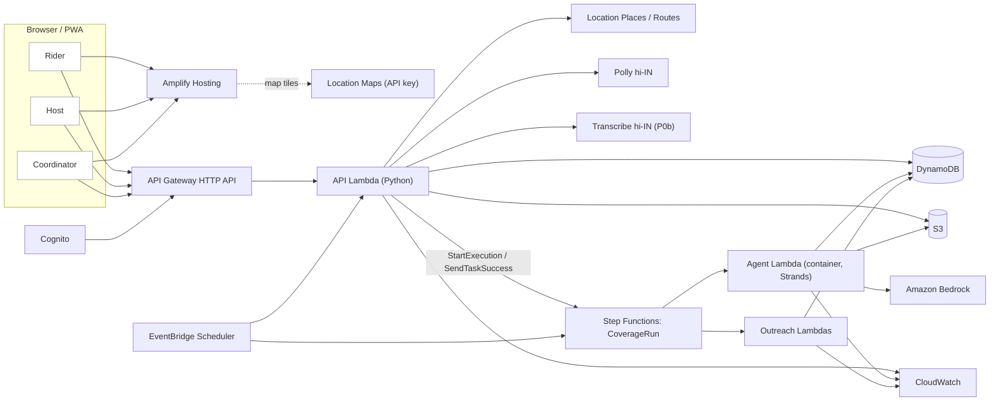
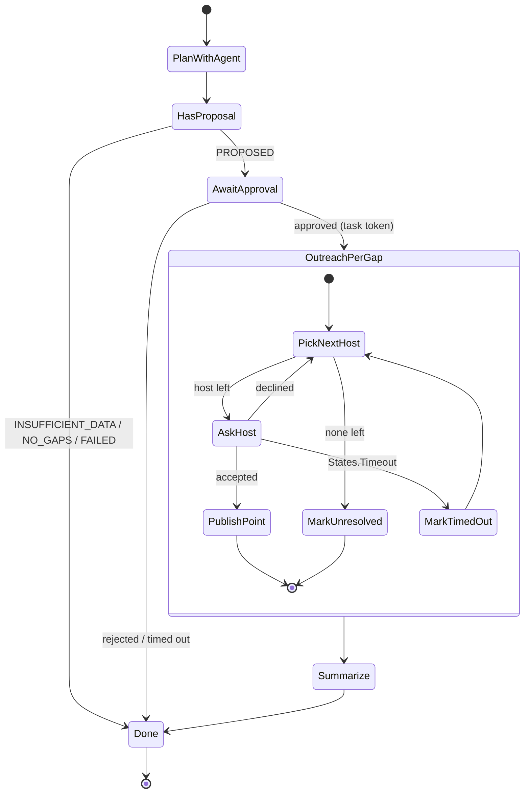

# AWS architecture

The architecture has one job in the video: make the agent's follow-through *visible*. A Step Functions graph that waits for a coordinator, asks a host, times out, asks the next host and publishes a point is the clearest picture of "where AWS fits". Build it so the console graph itself is a demo shot.

## Chosen stack

| Layer | Choice | Purpose |
|---|---|---|
| UI | React, TypeScript, Vite, Tailwind, MapLibre GL, installable PWA | Rider, host, coordinator and `/demo` room |
| Hosting | **AWS Amplify Hosting** | HTTPS frontend, SPA rewrites |
| Maps | **Amazon Location Service** — Maps (style + tiles via restricted API key), Places (reverse geocode host pins, server-side), Routes (`CalculateRoutes`, `TravelMode=Scooter`, server-side) | Real map, real addresses, two-wheeler route |
| Identity | **Cognito** user pool (groups `coordinator`, `host`) + JWT authorizer; signed demo-session tokens for `/demo` | Writes are authenticated; riders stay anonymous |
| API | **API Gateway HTTP API** + Python 3.12 **Lambda** | Short reads and validated commands (≤ 10 s) |
| Agent | Python **Strands Agents** on **Amazon Bedrock**, Lambda **container image** in **ECR** | Coverage planning with typed tools |
| Orchestration | **AWS Step Functions** Standard, `CoverageRun` state machine | Agent run → wait for approval → per-gap host outreach with task tokens and timeouts → publish → summary |
| Timers | **EventBridge Scheduler** | 18:30 IST nightly plan per active zone; 07:30 IST morning "still open?" pings |
| State | **DynamoDB** on-demand, single table + 2 GSIs | Zones, hosts, points, requests, runs, proposals, asks, events, demo sessions |
| Files | **S3** | Forecast snapshots, host photos (presigned upload), Polly audio cache |
| Voice | **Amazon Polly** (`hi-IN`, verify Kajal neural in T00; Aditi standard fallback) · **Amazon Transcribe** streaming `hi-IN` (P0b) | Spoken Hindi answer; spoken Hindi question |
| Weather | Open-Meteo forecast API (live), stored as snapshots in S3; synthetic fixture for the demo | Heat window per zone |
| Observability | **CloudWatch** logs, metrics, alarms; Step Functions execution history | Evidence with matching run IDs |
| IaC | **AWS CDK** (TypeScript) | One stack, repeatable, outputs for the frontend |
| Policy (P1) | **Cedar** via `cedarpy` inside the outreach Lambda | Outreach limits as reviewable policy (AWS open-source tool) |

Region: `ap-south-1` (Mumbai) for everything that is available there. `BEDROCK_REGION` / `BEDROCK_MODEL_ID` are explicit configuration verified by a real tool-use call in T00 (an APAC cross-region inference profile is acceptable if that is what works). Verify Polly `Kajal` + `hi-IN` and Transcribe streaming `hi-IN` in the chosen region in T00; record results in decisions.md.

## Topology

## Flow 1 — rider asks for help (synchronous, target < 2.5 s without voice)

1. `POST /help/find {need, lat, lng, lang, sessionId?}`. No account. Rate-limited per IP/device token.
2. Lambda loads live points for the zone (bounded ≤ 500 per zone; zone-partitioned query), filters in code: offers need, not paused, confirmed for the local date (or accepted window covers now), open now, within radius; sorts by haversine distance.
3. Calls Location `CalculateRoutes` (`TravelMode: Scooter`) for the best one; falls back to straight-line distance with a visible "approximate" label if Routes fails within 1.5 s.
4. Builds the spoken answer from a **fixed bilingual template** (not the model), e.g. *"सबसे पास पानी: RWA ऑफिस, 180 मीटर, दाएँ मुड़ें… शाम 5 बजे तक खुला।"* Polly synthesises `hi-IN` audio (cache by text hash in S3); returns JSON + presigned audio URL.
5. Logs a demand record: need, geohash-7 cell, local hour, answered/unanswered. Unanswered requests are the strongest gap signal for the agent.

Voice question (P0b): the browser records ≤ 8 s of 16 kHz mono PCM (Web Audio; MediaRecorder's webm/opus is not accepted by Transcribe streaming), `POST /help/ask-voice`, Lambda streams it to Transcribe `hi-IN`, maps the transcript to a need with keyword rules (`paani/water/पानी`, `chhaon/shade/छाँव`, `toilet/shauchalay/शौचालय`, `charge/charging`), and only if rules fail asks Bedrock for a one-word structured intent. Then same as step 2. Show the transcript on screen.

## Flow 2 — coverage run (asynchronous, the agent)

1. `POST /zones/{id}/coverage-runs {date, idempotencyKey}` (coordinator) or the nightly schedule creates a `Run` (QUEUED) and calls `StartExecution` with `name = runId` (Step Functions rejects duplicate names → idempotent). Returns 202.
2. **PlanWithAgent** (agent Lambda, timeout 180 s, application budget 120 s, retry ×2 on throttling only): Strands agent calls typed tools (agent.md), submits one structured proposal. The wrapper validates it against the deterministic candidate lists and stores `Proposal` (PROPOSED) with a content hash.
3. **AwaitApproval** (`lambda:invoke.waitForTaskToken`): stores the task token on the proposal. `TimeoutSeconds`: 6 h live, 15 min demo. `POST /proposals/{id}/approve` checks the hash, the revision and that the zone/forecast versions are unchanged, then calls `SendTaskSuccess` with the approved plan. Reject → `SendTaskFailure`.
4. **OutreachPerGap** (Map state over approved gaps, MaxConcurrency 3). Inside, a loop:
   - `PickNextHost` (Lambda): next host from the approved order that still passes policy (consent, not paused, ≤ 1 ask/host/day, inside host contact hours). None → `MarkUnresolved`.
   - `AskHost` (`waitForTaskToken`, `TimeoutSeconds` = 1200 live / 45 demo): writes an `Ask` with the token and shows it in the host's inbox (and email P1).
   - `POST /asks/{id}/respond {accepted|declined, window}` → conditional `OPEN → ANSWERED` → `SendTaskSuccess`. A late answer after timeout returns 409 with "This request already moved on — thank you."
   - `States.Timeout` → `MarkTimedOut` → loop. `accepted` → `PublishPoint`: conditional write of an availability window for that host/date, recompute coverage, write an event.
5. **Summarize** (Lambda, deterministic): before/after coverage, filled gaps, timed-out and declined asks, unresolved gaps with reasons. (P1: agent-written brief from those numbers.)
6. The UI polls `GET /runs/{id}` and `/runs/{id}/events` (2 s while active). Every state transition writes an event, so the coordinator panel mirrors the Step Functions graph.

Demo sessions pass `mode: "demo"` and the session ID in the execution input; timeouts come from the policy's demo values and the UI shows **Demo timers: 45 s** permanently.

## Flow 3 — schedules

- `nightly-coverage` (EventBridge Scheduler, 18:30 Asia/Kolkata): for each active live zone with ≥ 1 consenting host, start a run for tomorrow. Uses the live forecast snapshot; if it fails, the run ends `INSUFFICIENT_DATA` (never "no heat").
- `morning-freshness` (07:30 Asia/Kolkata): create a freshness ask for every listed host in active zones. Unconfirmed hosts stay visible but greyed and excluded from heat-window answers.
- P0 can trigger both by API button; the schedules are P0b. Demo sessions never use schedules — the presenter's buttons call the same code with the session clock.

## Reliability rules

- API never waits on the agent or a human. Agent Lambda never waits on a human — Step Functions holds the wait, at no compute cost.
- Idempotency: run start (execution name), approval (hash + idempotency key), host response (conditional status), publish (deterministic availability ID `hostId:date:runId`). Repeated clicks return the existing result.
- Approval of a stale proposal (zone hosts changed, forecast snapshot changed, policy changed) fails `STALE_INPUT`; replanning is a new run.
- All mutation gates use strongly consistent reads + `ConditionExpression`; GSIs are read-only views.
- Step Functions retries: Lambda service errors and Bedrock throttling only; validation failures end the run `FAILED` with a readable message.
- Model input is bounded: one zone, ≤ 24 hourly values, ≤ 12 clusters, ≤ 3 candidates per cluster.

## Authorization

- Riders: anonymous, `POST /help/*` and `POST /points/{id}/feedback` only, throttled (API Gateway route throttling + per-device counter).
- Hosts: Cognito group `host`; may edit only their own points and answer only asks addressed to them.
- Coordinators: Cognito group `coordinator` mapped server-side to zones; only they approve proposals.
- Demo: `POST /demo/sessions` creates an isolated copy of the fixture under `SESSION#id` and returns a signed token (HMAC, 2 h) that grants all three roles **inside that session only**. Global caps: 1 active run per session, 40 agent runs/day across all demo sessions; beyond the cap the coordinator panel offers the published saved run replay, labelled as a replay.
- No secrets in Vite env. The Location API key is restricted to map tile/style actions and the deployed + localhost referrers.

## Cost guardrails

AWS Budget alert, 7-day log retention, demo-session TTL 48 h, Polly audio cache, agent caps above. Report only measured cost.

## Why not more

No Kubernetes, no OpenSearch, no vector store, no multi-agent swarm, no WebSockets (polling at 2 s is enough and records well), no SQS (Step Functions already provides durable async execution, retries and waits). Add a service only when an acceptance criterion is blocked without it.
